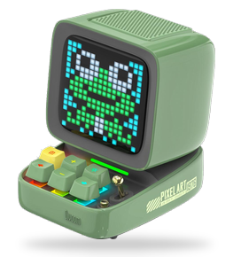
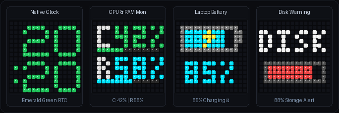
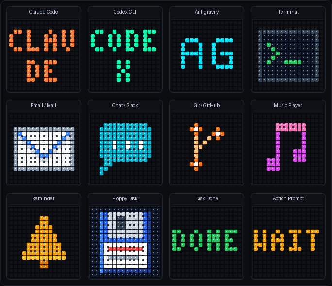

# Divoom Ditoo Controller — Linux Integration & Programmable Display

[](https://github.com/ih8d8/divoom-ditoo-controller/actions/workflows/ci.yml)
[](https://github.com/ih8d8/divoom-ditoo-controller/releases)
[](https://archlinux.org)
[](LICENSE)

A lightweight, non-invasive Linux integration and CLI controller for the **Divoom Ditoo Pro** retro Bluetooth speaker and 16×16 pixel-art display.

The controller idles the Ditoo Pro on its native digital clock face (styled in emerald green), intercepts desktop notifications from any **FreeDesktop notification system** (such as Dunst, Quickshell, Mako, or SwayNC), renders crisp 16×16 pixel typography and icons, provides host laptop battery monitoring & alerts, monitors Linux system resources (CPU/RAM), and automatically returns to the clock.

> [!NOTE]
> **Tested & Developed on Arch Linux**: This project was developed and extensively tested on **Arch Linux** (Linux kernel 6.12+ / 6.17+, BlueZ 5.79+, Hyprland, Dunst, Quickshell, PipeWire / WirePlumber). It is completely distro-agnostic and runs on Fedora, Ubuntu, Debian, NixOS, or any Linux distribution supporting BlueZ 5+ and D-Bus.

---

## Live Display Previews

<div align="center">
  <br/>
  <sub><em>Divoom Ditoo Pro — Retro Mechanical PC Desktop Companion with 16×16 RGB LED Pixel Display</em></sub>
  <br/><br/>

  <br/>
  <sub><em>Physical Display Screens: Emerald RTC Clock, Live CPU/RAM Sysmon, Laptop Battery Monitor, and Critical Disk Alert</em></sub>
  <br/><br/>

  <br/>
  <sub><em>Built-in 16×16 Pixel Art Icon Catalog (Claude Code, OpenAI Codex, Antigravity, Terminal, Mail, Chat, Git, Music, and Alerts)</em></sub>
</div>

---

## Key Features

- **Tested & Optimized for Arch Linux**: Seamlessly integrates with Arch Linux systemd user services, Dunst / Quickshell notifications, and the BlueZ Bluetooth stack.
- **Universal Desktop Notification Compatibility**:
  - The notification monitor listens directly to standard FreeDesktop D-Bus calls (`org.freedesktop.Notifications.Notify`).
  - **Dunst vs Quickshell vs Mako**: Works with **any** notification system out of the box! Switching from Dunst to a custom Quickshell widget, SwayNC, or `notify-send` requires zero configuration changes.
- **Dynamic Bluetooth Auto-Discovery**: Zero hardcoded MAC addresses. Automatically discovers and pairs with any Divoom/Ditoo device via BlueZ D-Bus, with support for `$DITOO_MAC` or `~/.config/ditoo/config.json`.
- **Host Laptop Battery Monitor**:
  - Automatically queries host laptop battery percentage and charging state directly via Linux sysfs (`/sys/class/power_supply/BAT*`).
  - **Smart Clock Override**: When your laptop battery drops below **10%**, the display automatically replaces the idle clock with a flashing low-battery alert icon to warn you to plug in your laptop.
  - **Charging Awareness**: Plugging the laptop into AC power instantly dismisses the low-battery warning and restores the clock face.
  - *(Desktop Safe)*: On desktop PCs without a battery, battery monitoring is cleanly bypassed with zero false alarms.
- **Zero-Overhead System Resource Monitor (Sysmon)**:
  - Reads directly from Linux procfs (`/proc/stat`, `/proc/meminfo`) and POSIX `statvfs` — zero external binary dependencies and negligible CPU overhead (<0.1ms).
  - Displays crisp CPU, RAM, and Disk metrics on the 16×16 screen.
  - The background daemon automatically alerts when CPU exceeds 75%, RAM exceeds 80%, or Disk storage exceeds 85%.
- **Extensible Icon & Asset System**:
  - Built-in embedded pixel-art catalog (Email, Chat, Calendar, Music, Terminal, Git, Bell, Claude, Codex, Antigravity, and status badges).
  - User custom icons: Simply drop any 16×16 `.png`, `.gif`, or `.divoom16` file into `~/.config/ditoo/icons/` to display it without recompiling.
  - Procedural badge fallback: Automatically generates 16×16 pixel cards for any custom label.
- **Generalized 16×16 Canvas & Widget Engine**:
  - High-level primitives: progress gauges (`show gauge`), dual-metric cards (`show card`), labeled metrics (`show metric`), and raw RGB pixel matrices (`show pixels`).
- **Dotfiles & Multi-Machine Safe**:
  - Built-in hardware guard (`ditoo-notification-daemon --check`). When synchronized across dotfiles (e.g. between a paired desktop and an unpaired laptop), systemd `ExecCondition` silently skips starting the daemon on machines without the device.
- **Resilient Auto-Connect on Boot**:
  - Automatically reconnects RFCOMM Channel 2 in the background on system startup or wake.
  - Limits connection retries to 3 attempts to prevent Bluetooth adapter congestion.
- **Ultra-Lightweight & Hardened Architecture**:
  - Memory: **~1.5 MB RSS**, CPU: **0.0% idle**.
  - Ephemeral render files are isolated strictly inside private user runtime directories (`$XDG_RUNTIME_DIR` or `/run/user/<uid>/ditoo/`) with atomic `0600` creation to prevent symlink attacks and race conditions (CWE-377).
  - Priority queue bounded to `MAX_QUEUE_SIZE = 64` with automatic low-priority eviction to safeguard against notification flood memory exhaustion (DoS).
  - IPC Unix domain socket is locked down to owner-only read/write (`0600`).
  - Audio coexistence: Stream A2DP Bluetooth music without interruptions while notifications and screen commands execute.
- **Interactive Shell Auto-Completions**:
  - Full tab-completion support for Bash, Zsh, and Fish via `ditoo completions <SHELL> --install`.

---

## Installation

### Method A: Prebuilt Binary (Direct Download)

Ideal for automated setup scripts, container environments, or quick installation:

```bash
# Download and extract the latest release tarball directly to ~/.local/bin (or any other directory in your PATH):
curl -sSL https://github.com/ih8d8/divoom-ditoo-controller/releases/latest/download/ditoo-linux-x86_64.tar.gz | tar -xz -C ~/.local/bin/ ditoo

# Or download the standalone executable directly:
curl -sSL -o ~/.local/bin/ditoo https://github.com/ih8d8/divoom-ditoo-controller/releases/latest/download/ditoo-linux-x86_64
chmod +x ~/.local/bin/ditoo
```

### Method B: Build from Source

The repository vendors all dependencies in-tree for completely self-contained builds without submodule management:

```bash
git clone https://github.com/ih8d8/divoom-ditoo-controller.git
cd divoom-ditoo-controller
cargo build --release

# Install binary and daemon to ~/.local/bin (or any other directory in your PATH):
cp target/release/ditoo ~/.local/bin/ditoo
cp target/release/divoom-ditoo-controller ~/.local/bin/divoom-ditoo-controller
cp scripts/ditoo-notification-daemon ~/.local/bin/ditoo-notification-daemon
chmod +x ~/.local/bin/ditoo* ~/.local/bin/divoom*
```

---

## Systemd Service Setup

Manage the background daemon as a systemd user service with portable `%h` home directory expansion:

```bash
mkdir -p ~/.config/systemd/user/
cp systemd/ditoo.service ~/.config/systemd/user/

systemctl --user daemon-reload
systemctl --user enable --now ditoo.service
```

### Multi-Machine Safety Guard
In `ditoo.service`:
```ini
ExecCondition=%h/.local/bin/ditoo-notification-daemon --check
ExecStart=%h/.local/bin/ditoo-notification-daemon
```
*(Adjust the path if you installed your binaries to a different directory in your `PATH`, such as `/usr/local/bin` or `~/bin`).*

- **On machines with a paired Ditoo**: The check succeeds and the service starts normally.
- **On machines without a paired Ditoo**: The check exits cleanly with code 1, and systemd silently skips starting the unit with zero failure warnings.

---

## Notification Daemon & Window Managers

The notification daemon monitors the standard FreeDesktop D-Bus interface:
```bash
dbus-monitor --session "type='method_call',interface='org.freedesktop.Notifications',member='Notify'"
```

Because this is the universal Linux notification specification, the daemon works interchangeably with:
- **Dunst**
- **Quickshell** custom notification widgets
- **Mako** (Sway / Wayland)
- **SwayNC** (Sway Notification Center)
- **KDE / GNOME** desktop notifications
- Standard CLI notifications (`notify-send "Subject" "Message"`)

If you switch from Dunst to a custom Quickshell QML notification center, **it works immediately with zero changes**.

---

## Extensible Icon & Asset System

The controller features a multi-tiered icon resolution system that allows anyone to extend and customize the display without touching the source code:

```
Icon Request (--icon <name>)
    │
    ├── 1. Direct File Path (e.g. ./my_art.png or /path/to/animation.divoom16)
    │
    ├── 2. User Asset Directory (~/.config/ditoo/icons/):
    │       • ~/.config/ditoo/icons/<name>.png  (dotfiles-friendly)
    │       • Secondary fallback: ~/.local/share/ditoo/icons/<name>.png
    │
    ├── 3. Embedded Built-in Catalog (Compiled directly into the binary):
    │       • mail        (Email envelope with blue crease)
    │       • chat        (Cyan rounded speech bubble with message dots)
    │       • calendar    (Desk calendar with red header and rings)
    │       • music       (Vibrant magenta double eighth notes)
    │       • terminal    (Dark shell frame with neon green prompt >_)
    │       • git         (Orange git commit branch tree)
    │       • bell        (Golden alert chime)
    │       • claude      (Coral 2-line AI badge)
    │       • codex       (Emerald OpenAI Codex badge)
    │       • antigravity (Cyan Deepmind Antigravity badge)
    │       • done        (Green checkmark)
    │       • error       (Red exclamation mark)
    │       • alert       (Amber warning badge)
    │       • busy        (Purple spinner animation)
    │       • info        (Sky blue notice)
    │       • disk        (Retro 3.5" floppy diskette)
    │
    └── 4. Procedural 16×16 Badge Fallback:
            • If no matching file exists, automatically renders a 16×16
              card with the word centered in 3×5 typography on a colored
              background (e.g. --icon zoom, --icon docker, --icon rust).
```

### Adding Your Own Custom Icons
All user configuration and custom icons live in one single place: `~/.config/ditoo/` (making it trivial to version-control in your dotfiles repository):

1. Create any 16×16 pixel art image in PNG, GIF, or `.divoom16` format.
2. Drop it into `~/.config/ditoo/icons/<name>.png`:
   ```bash
   mkdir -p ~/.config/ditoo/icons/
   cp my_app_logo.png ~/.config/ditoo/icons/firefox.png
   ```
3. Whenever `firefox` sends a desktop notification (or when you run `ditoo notify "Download complete" --icon firefox`), the controller will automatically load and display your custom pixel art!

---

## CLI Usage Reference

### Notifications & AI Coding Agents
```bash
# Send notifications (holds 5s, then automatically restores native clock)
ditoo notify "Claude: Task Complete" --icon claude
ditoo notify "OpenAI Codex: Finished" --icon codex
ditoo notify "Antigravity: Done" --icon antigravity
ditoo notify "New Email from Team" --icon mail
ditoo notify "Slack: Direct Message" --icon chat
ditoo notify "Calendar: Meeting in 5m" --icon calendar
ditoo notify "Spotify: Now Playing" --icon music
ditoo notify "Build Succeeded" --icon done
ditoo notify "Build Failed" --icon error
ditoo notify "Approval Required" --icon alert --priority urgent --sound
```

### Icon & Widget Showcase
Cycle through all built-in pixel-art icons, battery gauge, and system monitor cards in sequence on the physical screen:
```bash
# Display every icon and widget for 5 seconds each, then automatically restore native clock
ditoo showcase

# Custom cycle duration (e.g. 3 seconds per icon)
ditoo showcase --interval 3
```

### Laptop Battery Monitor
```bash
# Query and display host laptop battery status on the 16x16 screen (5s duration)
ditoo battery

# Only print laptop battery status to terminal without updating the display
ditoo battery --status-only

# Preview/test battery widget with a custom percentage (e.g. 15% charging)
ditoo battery 15 --charging
```

### Linux System Resource Monitor (Sysmon)
```bash
# Display live CPU & RAM usage card on screen
ditoo sysmon

# Display live Disk filesystem gauge
ditoo show disk

# Print current CPU, RAM, and Disk metrics to terminal
ditoo sysmon --status-only
```

### Generalized 16×16 Canvas & Widgets (`ditoo show`)
```bash
# Display a progress gauge bar (e.g. CPU at 75%)
ditoo show gauge CPU 75 --color cyan

# Display a 2-line high-contrast card
ditoo show card "AG" "DONE" --top-color cyan --bottom-color green

# Display a single labeled metric
ditoo show metric TEMP 52C --color amber

# Display dual CPU & RAM live monitor
ditoo show sysmon

# Display custom raw 16x16 pixel matrix (256 space/comma separated hex colors)
ditoo show pixels "000000 000000 FF0000 ..."
```

### Clock & Screen Power Management
```bash
# Switch display back to native digital clock mode (green digits)
ditoo clock

# Synchronize hardware RTC clock with Linux system time
ditoo sync-time

# Display power on / off
ditoo screen on
ditoo screen off

# Screen brightness control (0-100)
ditoo brightness 70

# Query hardware connection status and audio volume
ditoo status
```

### Shell Auto-Completions (`ditoo completions`)
Generate and install tab-completion scripts for your shell:
```bash
# Automatically install completions for Bash into ~/.local/share/bash-completion/completions/
ditoo completions bash --install

# Install completions for Zsh or Fish
ditoo completions zsh --install
ditoo completions fish --install

# Or output directly to stdout / source in your current shell
source <(ditoo completions bash)
```

---

## Configuration

Zero configuration is required for single-device setups. If multiple Ditoo devices are paired or you prefer explicit settings, edit `~/.config/ditoo/config.json`:

```json
{
  "device_mac": "11:22:33:44:55:66",
  "default_brightness": 50,
  "clock_color": "green",
  "icons_dir": "~/.config/ditoo/icons",
  "sound": {
    "enabled": false,
    "command": "paplay /usr/share/sounds/freedesktop/stereo/complete.oga"
  }
}
```

Or set the environment variable:
```bash
export DITOO_MAC="11:22:33:44:55:66"
```

---

## Architecture & Technical Documentation

- [Hardware & Bluetooth Profiles](docs/hardware.md)
- [Protocol Specification](docs/protocol.md)
- [Software Architecture](docs/architecture.md)

---

## Acknowledgments & Upstream Attribution

This project builds upon the foundational reverse-engineering work and low-level Bluetooth protocol libraries from:
- [**futpib/divoom-ditoo-pro-controller**](https://github.com/futpib/divoom-ditoo-pro-controller) by **[futpib](https://github.com/futpib)** (MIT License):
  - Provides the enhanced in-tree protocol engine, Bluetooth Classic SPP/RFCOMM packet framing, and display primitives vendored in `vendor/divoom-ditoo-pro-controller`.
  - Packaged on the Arch User Repository (AUR) as [`divoom-ditoo-pro-controller-git`](https://aur.archlinux.org/packages/divoom-ditoo-pro-controller-git).
- [**andreas-mausch/divoom-ditoo-pro-controller**](https://github.com/andreas-mausch/divoom-ditoo-pro-controller) by **[andreas-mausch](https://github.com/andreas-mausch)**:
  - The original upstream reverse-engineering research and initial protocol implementation ([Technical Article](https://andreas-mausch.de/blog/2023-08-14-divoom-ditoo-pro/)).

We extend our sincere credit and appreciation to both **futpib** and **andreas-mausch** for their pioneering work on Divoom Ditoo reverse engineering. The upstream protocol crate is vendored in `vendor/divoom-ditoo-pro-controller` to ensure fully self-contained, reproducible builds without external system-level package requirements.

---

## License

This project is licensed under the [MIT License](LICENSE).
