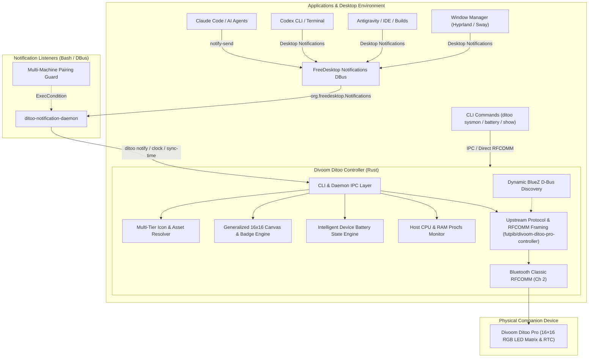

# Divoom Ditoo Linux Integration — Architecture & Design

## 1. Architectural Overview

---

## 2. Core Architectural Principles

1. **Non-Invasive Universal Desktop Interception**:
   - Zero application-level hacks: Claude Code, OpenAI Codex, Antigravity, and terminal builds simply invoke standard desktop notifications (`notify-send` or desktop notification libraries).
   - The daemon monitors the standard FreeDesktop D-Bus interface (`org.freedesktop.Notifications.Notify`), ensuring 100% compatibility with **Dunst**, **Quickshell**, **Mako**, **SwayNC**, and native desktop environments.
   - Intelligent keyword classification identifies apps, agents, warnings, errors, and completions, with a clean `info` fallback for uncaught messages.

2. **Portable Pairing Guard (Multi-Machine / Dotfiles Safe)**:
   - Dotfiles can be shared across multiple machines (e.g., desktop PC and laptops) without error.
   - The systemd unit specifies `ExecCondition=%h/.local/bin/ditoo-notification-daemon --check` (or any directory in your `PATH`).
   - On machines where a Ditoo Pro is **not paired**, the check exits with code 1, and systemd silently skips execution with zero log noise.
   - On machines where the device **is paired**, the service starts immediately.

3. **Native Clock First (Green LED Face)**:
   - The Ditoo Pro operates primarily as an ambient digital desktop clock powered by its onboard RTC chip styled with custom emerald green digits (`#00FF00`).
   - When an incoming notification or widget is displayed, it shows for a configurable duration (default 5 seconds), then automatically restores the native clock (`0x45`).
   - The RTC clock is synchronized to Linux system time automatically on connection and hourly (`0x18`).

4. **Intelligent Device Battery Management**:
   - Device battery is tracked continuously via BlueZ D-Bus (`org.bluez.Battery1`) and connection session discharge models.
   - **Critical Threshold (<10%)**: Replaces the clock with an explicit low-battery warning canvas so the user is prompted to plug it in before shutdown.
   - **Smart Charging Override**: Plugging the device in instantly restores the clock, even if the battery has not yet reached 10%.

5. **Extensible Plugin & Asset System (`~/.config/ditoo/icons/`)**:
   - All custom pixel-art icons are located in `$XDG_CONFIG_HOME/ditoo/icons/` (`~/.config/ditoo/icons/<name>.png`).
   - Users can add custom 16×16 icons for any app or script without recompilation.
   - Procedural badge fallback automatically synthesizes 16×16 cards for unrecognized applications using high-contrast 3×5 typography.

6. **Zero-Overhead Linux System Monitoring (Sysmon)**:
   - Reads directly from Linux procfs (`/proc/stat`, `/proc/meminfo`) and POSIX `statvfs` with sub-millisecond execution times and zero external dependencies.
   - Alerts on high CPU (>75%), RAM (>80%), or Disk filesystem storage (>85%) utilization directly on the LED screen.

7. **Audio & Display Coexistence**:
   - Uses RFCOMM Channel 2 exclusively for display commands (SPP), leaving Channel 1 and A2DP profiles uninhibited for seamless Bluetooth audio playback.

8. **Security & Resource Hardening**:
   - **Ephemeral File Isolation**: Render frames and temporary icons are written to a user-isolated runtime directory (`$XDG_RUNTIME_DIR/ditoo/` or `/tmp/ditoo-<uid>/` with `0700` permissions) using `O_CREAT | O_EXCL` and `0600` mode, completely eliminating symlink attacks and race conditions (CWE-377).
   - **Queue Flooding Mitigation**: The IPC notification queue enforces a hard cap (`MAX_QUEUE_SIZE = 64`), automatically evicting oldest/lowest-priority entries under notification storms.
   - **IPC Socket Hardening**: The Unix domain socket is bound with `0600` permissions to block unprivileged local multi-user eavesdropping or tampering.
